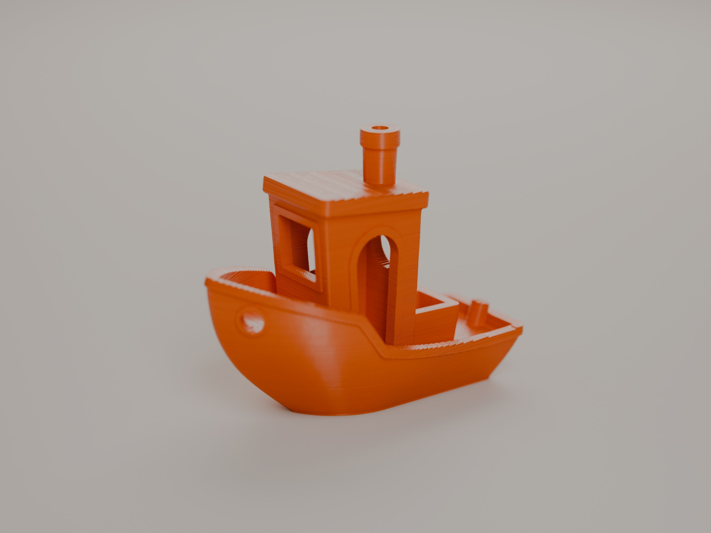
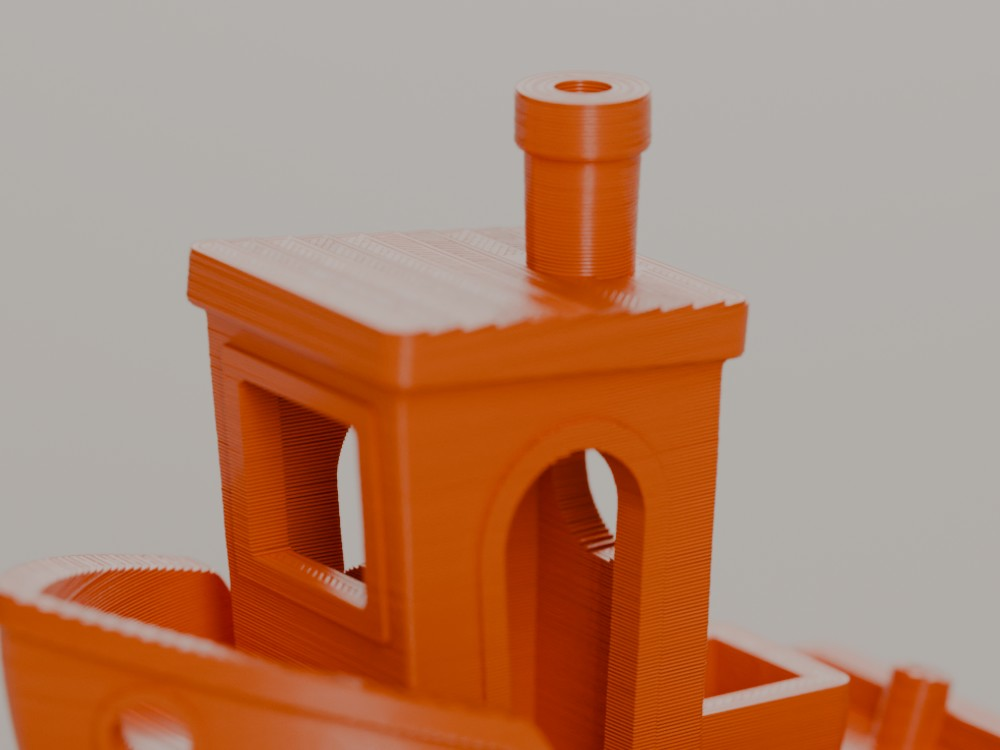
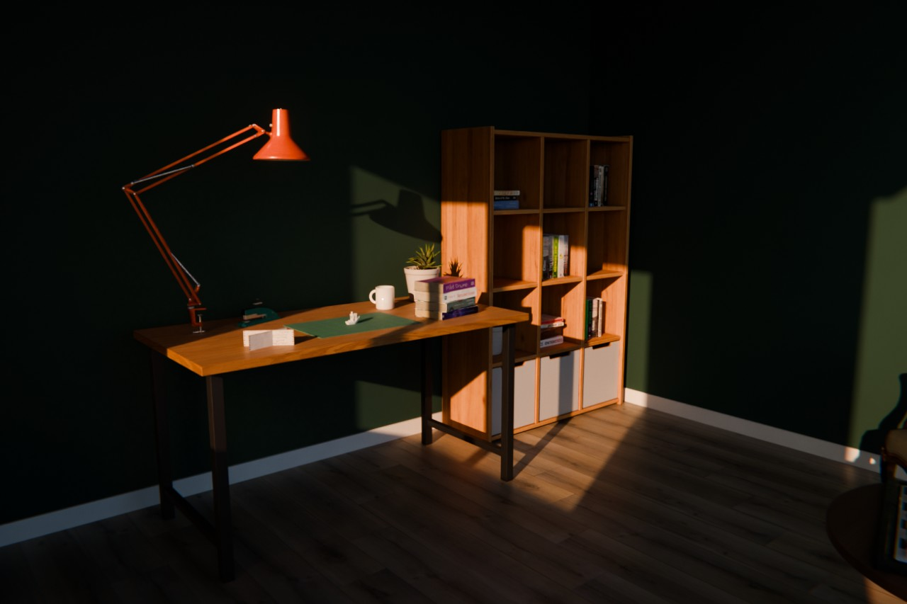
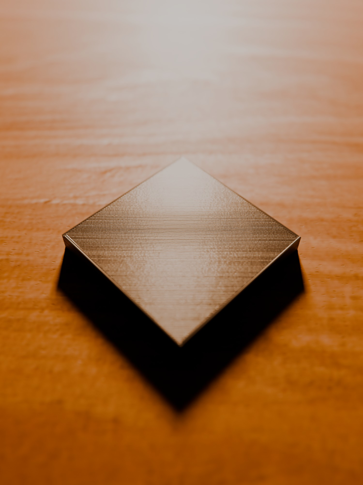

# 3D Print Studio — Blender add-on

A Blender add-on that turns 3D-print models into photorealistic "already printed" renders:
real sliced layer geometry at true scale, slicer-accurate top/bottom skin, printer flaws,
a filament palette, scanned photo textures and ready-made rooms and props.
Requires Blender 4.2+ (tested with 5.2).



| 100 % crop | Desk scene | Top layer test |
|---|---|---|
|  |  |  |

## Installation

1. Build the zip with Blender's own Python:
   `"C:/Program Files/Blender Foundation/Blender 5.2/blender.exe" -b --factory-startup --python tools/package.py`
   → creates `dist/print3d_studio-1.0.0.zip`.
2. Blender → *Edit > Preferences > Get Extensions* → ▾ in the top right → **Install from Disk…** → pick the zip.
3. In the 3D Viewport press **N** → **3D Print** tab.

To try it during development without installing:

```bash
"C:/Program Files/Blender Foundation/Blender 5.2/blender.exe" --python tools/dev_start.py
```

## Quick start

1. Import your STL/3MF model and select it.
2. **One-Click Scene** → the model is scaled from millimeters to real size, sliced into
   real layers and given the filament material; a room and desk are built and furnished
   (**Furnish Room and Desk**), the model is set on the mat, and lighting, a product camera and
   Cycles are configured.
   - On the desk: cutting mat, arm lamp clamped to the back edge, small potted plant, a stack of
     scanned books, mug, postcards, vintage stapler.
   - In the room: display shelves dressed with books, a plant and a lighter; a floor plant by
     the window; a green armchair with a chess set on a coffee table.
   - **Room + Desk (Cinematic Sun)** (the default): a low, strong, warm sun through the window,
     little sky light, high-contrast AgX, faint haze that shows the sun beams, and a low, wide
     open product camera so the desk props melt into bokeh. The other presets are Daylight,
     Golden Hour, Evening (the desk lamp is switched on) and Studio (the furniture is hidden and
     comes back with the room).
   - The room furniture adapts to the room size: when you shrink the room, what no longer fits
     is hidden and returns when there is space again. A piece you moved by hand stays yours and
     just keeps its distance to the walls.
   - Things standing on something move with it: decor with the desk, books with the shelves,
     the chess set with its table. **Drag on Surfaces** is turned on: while you move the model
   (G or the Move tool) it sits on the desk, mat, books or floor under the cursor. The viewport switches to the camera.
3. **Render > Render Image** (F12).

## Panels

| Panel | Contents |
|---|---|
| Print & Filament | Type / Color, Layer Height, Line Width, **Direction** (print orientation: Z+/Z-/X/Y/Custom Angle), Layer Visibility, Layer Irregularity, Seam, Top Surface Lines, Real Layer Geometry, Print Imperfections, Dust & Handling, Color Cycle Height. Changes apply live. |
| Material Library | Wood (incl. scanned photo woods), metal, stone, fabric, leather, glass, ceramic, walls/floors, cutting mat, PEI… Every material comes with its own surface relief (bump). |
| Room & Environment | Room built to size (walls/floor, window, ceiling, baseboard) or a curved studio backdrop. |
| Props | Built: desk, coffee table, chair, bookshelf, wall shelf, book stack, mug, pen cup, cutting mat, PEI build plate, laptop, rug, picture frame. Scanned (Poly Haven, CC0, shipped): desk and floor plants, green armchair, dining chair, low wooden table, modern coffee table, display shelves, chess set, arm desk lamp (with a real light), book rows and stacks, postcards, vintage stapler and lighter, street lamp, wall lantern. Plus your own asset library. |
| Camera Controls | In camera view: **Pick Focus Point** (click any point; the focus stays on it even when the camera or object moves), bokeh / f-stop, Move (forward/back, up/down, left/right), Turn in Place (pan, tilt, roll), Orbit Around Focus, step sizes. |
| Lighting & Camera | Cinematic Sun (with Light Shafts), Daylight (Window), Golden Hour, Studio, Evening, HDRI. Product camera: focus, aperture (bokeh), angle, roll. |
| Render | Preview / Final / Ultra, social-media sizes, GPU, Lens Effects. |
| Extend Palette | Permanently add new filament colors and materials. |

## How the realism works

### Real layer geometry
- **Real Layer Geometry** (on by default): like a slicer, the model is cut at the middle of
  every layer and rebuilt one layer height thick (`scene/slicer.py`). Sloped tops become real
  terraces (a 5.5° roof at 0.2 mm gives ~2 mm steps) and silhouettes become real stair steps.
- The original mesh is kept; turn the option off to get it back (e.g. to edit the model).
- Benchy at 0.2 mm: 240 layers, ~16 s to slice.
- On non-manifold meshes, open contours are bridged across gaps up to 5 layer heights.
- Layer caps are watertight: the perimeter band and infill share vertices, and points added
  while splitting triangles are welded into neighbouring faces, so no hairline cracks show.

### Surface rule (like a slicer)
Every cap face is classified (`p3d_skin` attribute):
- **Top skin** where nothing is printed above it: two perimeter loops along the outline, then
  45° infill alternating per layer. The true distance from the outline is stored per face
  corner (`p3d_edge`) and narrows on thin walls.
- **Bottom skin** where nothing is printed below it (overhangs): sagging, matte lines.
- **Bed side** for the first layer: pressed flat and glossy.
- Ledges narrower than ~0.25 mm (≈ 0.6 line widths) and covered faces get no skin, so the
  micro steps that Z wobble leaves on walls stay clean.
- Cap triangles that straddle the exposed/covered border are bisected along their longest
  edge until the class is clear.

### Lines and printer flaws
- Layer lines are computed at real scale (bump distance = one real layer, no exaggeration).
  They become visible in close-ups and at 2K+ resolution.
- Top lines are never laser straight: every line has its own height and gloss, wanders
  slightly and ripples along its length with ~0.5 mm extrusion pulses.
- **Print Imperfections** (1 = a well-tuned hobby printer): ~0.01 mm Z wobble from an 8 mm
  lead screw, ~0.008 mm width variation between layers, 0.15 mm elephant foot on the first layer.
- **Dust & Handling**: sparse dust specks on upward faces and faint matte handling marks.
- All edges are rounded by ~0.07 mm (Bevel).
- With Real Layer Geometry off, the shader fakes the same terraces (flat steps
  `layer / tan(slope)` wide, rounded perimeter edge, two perimeter lines, diagonal infill).
- STLs arrive flat shaded; when the material is applied, curved areas are smoothed and edges
  sharper than 35° stay crisp.

### Camera
- **Lens Effects** (Render panel): slight lens distortion and chromatic aberration, bloom,
  vignetting and sensor grain.
- **Camera Roll**: a natural 0.6° tilt of the horizon.

### Scene materials
- **Photo textures (Poly Haven, CC0):** the "(Photo)" materials under Material Library > Wood
  and the desk use real scanned wood (color + normal + roughness at true size, e.g. Oak Veneer
  1.83 m).
  - They are downloaded on first use and cached in the user folder. This needs
    *Preferences > System > Network > Allow Online Access*. When it is off, another cached
    resolution is used; if none exists, procedural wood is used instead.
  - Resolution is set in the add-on preferences under *Photo Texture Resolution*
    (default 4K ≈ 43 MB per wood, 8K ≈ 150 MB).
  - Fibres and pores smaller than one texel are added procedurally.
  - Props are built with real-scale box-projected UVs (1 UV unit = 1 m).
- **Red Brick Wall:** our own 2K PBR set (`assets/textures/BrickRedOwn`: color, normal,
  roughness, height, AO), generated with AI by the author and shipped with the add-on. It tiles
  seamlessly at 1.8 m (24 courses of 7.5 cm). The normal map's X channel was flipped to OpenGL
  and the gloss map dropped.
- **Poly Haven sets (CC0, shipped):** 4K JPG conversions of Poly Haven's downloads (EXR/PNG maps to JPG), at
  the real size given in each set's .blend.
  - Walls: Plastered Brick Wall, White Stucco, White Stucco Coarse, Layered Concrete Wall.
  - Floor: Old Wooden Floor.
  - Material Library > Fabric & Leather: Brown Leather (Scan), Leather-Look Fabric, Hessian
    (Burlap).
  - Material Library > Fabric & Leather also has Wool Bouclé.
  - The relief depth comes from each set's displacement scale.
- **Poly Haven models (CC0, shipped)** in `assets/models`: `GreenChair_01`, `dining_chair_02`,
  `WoodenTable_01`, `modern_coffee_table_02`, `wooden_display_shelves_01`, `chess_set`,
  `desk_lamp_arm_01`, `decorative_book_set_01`, `postcard_set_01`, `potted_plant_02`,
  `potted_plant_04`, `vintage_stapler`, `vintage_lighter`, `street_lamp_01`, `street_lamp_02`.
  - Maps were converted to JPG (PNG where the alpha is used) at the resolution the object
    needs, about 0.25 mm per pixel: 4K for furniture, 1-2K for small things like books.
  - Book rows, book stacks and postcards take single objects out of the book and postcard sets.
  - The desk lamp is held by its C clamp on the desk edge and posed with its own rig so the
    shade looks down onto the desk; a spot light sits in the shade and is on only in the
    Evening preset.
- **Wall relief:** on the room walls and floor, textures with a height map get true
  displacement (Cycles adaptive subdivision), so mortar joints cast real shadows. Walls are
  built as one connected mesh so the displaced surface has no cracks.
- **Cutting mat:** matte PVC micro texture, mint grid, ruler ticks along the edges, diagonal
  guide lines, light knife marks and a lighter core layer visible on the edge.

## Memory

The full furnished scene needs about 4 GB at 2048 x 2048 (textures ~1.2 GB, the sliced model,
relief geometry, render buffers), on top of what Blender itself holds.
- Displaced walls and floors are cut into 40 cm cells and split at most 2^8 times per side, so
  a close camera can not dice them into hundreds of millions of micro faces.
- Grayscale maps (roughness, height, AO, metal) are single-channel JPGs: a quarter of the memory.
- Persistent Data is off: no second copy of the scene stays in memory after a render.
- If a final render still runs out: switch the viewport to Solid first (Material Preview keeps
  every texture in VRAM too) and close other GPU-heavy programs. Rendering the saved file from
  the command line (`blender -b scene.blend -f 1`) needs the least memory.

## Local asset library (downloaded textures and models)

**Props > My Asset Library > Import Asset Zips…** takes zips from ambientCG, Poliigon and
similar sites (file names like `_COL_4K`, `_NRM`, `_ROUGHNESS`, `BaseColor`, `Normal`…):
- A zip with a `.blend` file is a **model**. It is listed in *My Asset Library* and appended
  at real size with its own materials; a texture missing at one resolution is replaced by
  the same map at another.
- A zip with only maps is a **texture**. It becomes a "(Library)" material using the `pbr`
  builder (color, normal, roughness or gloss, metal, AO, opacity, height). Maps larger than
  *Photo Texture Resolution* are scaled down once on import.
- Files go to `<user folder>/library/`, never into the add-on or this repository (most
  download licenses forbid redistributing them).
- From the command line: `blender -b --factory-startup --python tools/import_assets.py -- <library folder> 4 a.zip b.zip`.

## Plank floor from your own photo

The floor is laid out by the `planks` shader the way it is installed: boards of one width and
one length, each row's end joints shifted by a fixed amount (19 cm x 121.5 cm boards, 24 cm
stagger for the default floor). Every board shows a random real board from an atlas, sometimes
turned 180 degrees, and gets bevelled grooves along its edges, so the floor never repeats in a
grid.

`tools/make_floor_atlas.py` makes that atlas from a top-down photo: it straightens the boards
(camera tilt and perspective), removes light falloff and color cast, finds the end joints and
cuts out every whole board (the longest one gives the board length unless you pass it).

```bash
"C:/Program Files/Blender Foundation/Blender 5.2/blender.exe" -b --factory-startup --python tools/make_floor_atlas.py -- photo.jpg print3d_studio/assets/textures/MyFloor MyFloor 190 [length mm]
```

**Chevron:** `tools/make_chevron_atlas.py` does the same for a chevron floor: it finds the band
lines and the slant of the boards (the V joints), cuts out every whole board and stores the
joint spacing, band depth and slant; the `chevron` shader lays the bands out with the slant
flipping every band and draws the grout. Pass the board width in mm (measured square to the
long edges):

```bash
"C:/Program Files/Blender Foundation/Blender 5.2/blender.exe" -b --factory-startup --python tools/make_chevron_atlas.py -- photo.jpg print3d_studio/assets/textures/MyChevron MyChevron 70
```

The default floor (**Oak Laminate (Photo)**) comes from our own photo and ships with the add-on
(`assets/textures/LaminateOakPhoto`); **Oak Chevron Tiles (Photo)** (7 cm boards) likewise
(`assets/textures/ChevronOakPhoto`). All floor textures are our own, so they can be shared. Board width, length and stagger can be overridden with
`board_w`, `board_len` and `stagger` in `data/materials.json`.

## Extending the palette

- From the panel: **Extend Palette**. Additions are written to the user folder
  (`user_filaments.json`, `user_materials.json`) and survive updates.
- Your own props: select them → **Props > My Asset Library > Save**, or put `.blend` files in
  `print3d_studio/assets/` or in the *Extra Asset Folder* set in the preferences.
- In code: `data/filaments.json`, `data/materials.json`, material builders in
  `materials/surfaces.py`, props in `scene/furniture.py` (`@item(...)`).

## Tests and calibration

```bash
# full scene + every prop, in the background
"C:/Program Files/Blender Foundation/Blender 5.2/blender.exe" -b --factory-startup --python tools/test_render.py -- renders/test.png DESK_DAY 64 PLA_SILK --all
# close-up realism check on the desk
"C:/Program Files/Blender Foundation/Blender 5.2/blender.exe" -b --factory-startup --python tools/closeup_test.py -- renders/close.png 384 PLA_BASIC 1.15 14
# 1:1 calibration render of a real STL on a studio backdrop
"C:/Program Files/Blender Foundation/Blender 5.2/blender.exe" -b --factory-startup --python tools/benchy_calib.py -- samples/benchy.stl renders/benchy.png "#F2621B" "#D6D3CE" 145 18 512 2400
# top-surface check: a 40 x 40 x 5 mm square on the desk under a grazing lamp
"C:/Program Files/Blender Foundation/Blender 5.2/blender.exe" -b --factory-startup --online-mode --python tools/top_test.py -- renders/top.png 256
# UI test in a real Blender window (screenshots go to renders/ui)
"C:/Program Files/Blender Foundation/Blender 5.2/blender.exe" --factory-startup --python tools/ui_test.py -- renders/ui
```

## License and credits

- Add-on code: [GPL-3.0-or-later](LICENSE) (required for Blender add-ons).
- Textures and models from [Poly Haven](https://polyhaven.com), CC0: the wood photo textures
  are downloaded on first use; the wall, floor and fabric sets and the models listed above ship
  in `print3d_studio/assets`.
- Red Brick Wall and the oak floors: made by the author, released with the add-on.
- No asset in this repository is under a license that forbids redistribution.
- Sample model: #3DBenchy by Creative Tools, CC BY-ND 4.0 — see [samples/README.md](samples/README.md).
